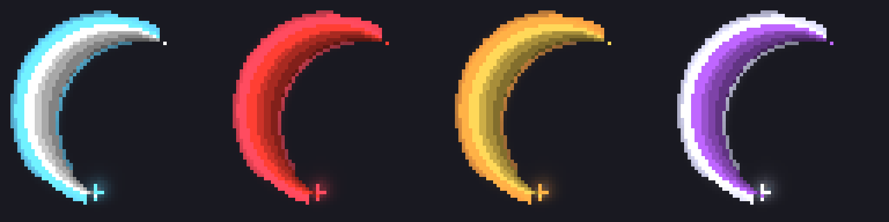

# Aura slash (contoh)

Remake slash pedang pakai pixelfx. Frame 64x64, 11 frame, 30 fps (0.367 detik). Belum masuk ke `packs/`, ini contoh doang.



## Isi folder

- `textures/aura_slash_core.png`: blade-nya, strip vertikal 64x704, grayscale. Yang ini di-tint jadi warna tengah.
- `textures/aura_slash_aura.png`: aura, rim halo bertingkat, cahaya, spark di ujung, wisp. Grayscale juga, di-tint terpisah.
- `textures/*_mirror.png`: versi tangan sebaliknya. Yang biasa cembung ke kiri dan muter dari atas lewat kiri ke bawah, sama kayak `slash_effect_white_2`. Yang `_mirror` sama kayak `slash_effect_white`.
- `particles/aura_slash_core.particle.json` (`ph:aura_slash_core`, material `particles_alpha`).
- `particles/aura_slash_aura.particle.json` (`ph:aura_slash_aura`, material `particles_add`, jadi glow-nya nambah terang).
- `example.ts`: contoh spawn dari script dengan warna custom.
- `preview/`: `contact_tints.png` sama `aura_slash.gif`, 4 kombinasi warna.
- `source/aura-slash.js`: source effect pixelfx-nya.
- `build.py`: render ulang texture + preview dari source.

Satu slash = dua particle yang di-spawn di titik yang sama. Core sama aura dipisah karena satu particle cuma bisa punya satu tint.

## Ngatur warna

Variable-nya dibaca pakai `??`. Kalau nggak di-set, yang dipakai default-nya.

| variable | buat | default |
|---|---|---|
| `v.core_r` `v.core_g` `v.core_b` | warna tengah (blade) | 1, 1, 1 (putih) |
| `v.aura_r` `v.aura_g` `v.aura_b` | warna aura | 0.35, 0.85, 1 (cyan) |
| `v.slash_spin` | rotasi crescent, derajat | 0 |
| `v.slash_size` | ukuran billboard, blok | 1.5 |

Dari script, pakai `MolangVariableMap` (lihat `example.ts`). Dari animasi weapon, set lewat `pre_effect_script`:

```json
"particle_effects": {
    "0.1": [
        { "effect": "aura_slash_aura", "locator": "slash", "pre_effect_script": "v.aura_r = 1; v.aura_g = 0.2; v.aura_b = 0.25;" },
        { "effect": "aura_slash_core", "locator": "slash", "pre_effect_script": "v.core_r = 1; v.core_g = 0.25; v.core_b = 0.2;" }
    ]
}
```

`aura_slash_aura` sama `aura_slash_core` harus didaftarin dulu di `particle_effects` milik `player.entity.json`, sama kayak `the_bleeding_spire_attack_1`.

Tint di Bedrock itu multiply. Jadi bagian putih di texture jadi persis warna yang dipilih, yang abu jadi versi gelapnya. Warna hitam (0, 0, 0) bikin layer-nya ilang.

## Masukin ke pack

1. Copy `textures/*.png` ke `packs/RP/textures/particle/`.
2. Copy `particles/*.json` ke `packs/RP/particles/`.
3. Spawn dua-duanya, aura duluan.

## Render ulang

```bash
python3 tes/build.py ~/pixelfx
```

Butuh Node 18+, Pillow, numpy, sama checkout pixelfx. Kalau `src/fx/melee/aura-slash.js` belum ada di checkout, script-nya copy dari `source/`. Edit effect-nya di checkout pixelfx, terus copy balik ke `source/`.

## Udah masuk pack

Semua slash pakai aura slash sekarang. Texture-nya di `packs/RP/textures/particle/aura_slash/`, termasuk `*_reverse.png` (versi `_mirror` yang tiap frame-nya dibalik atas-bawah, buat attack 3 Supercharged Copper Axe sama Auric Photonizer).

Tiap slash punya dua file: `<id>.particle.json` (aura, `particles_add`) sama `<id>_core.particle.json` (core, `particles_alpha`). Warnanya di-bake per file, soalnya emitter anak nggak ikut dapet variable dari parent. Aura nge-spawn core lewat creation event (`emitter_bound`), jadi animasi cukup manggil satu alias. Pengecualian Forge Trooper: slash-nya butuh `variable.slash_angle` dari `pre_effect_script`, jadi core-nya dipanggil sendiri di animasi (`forge_slash_<varian>_core`).
